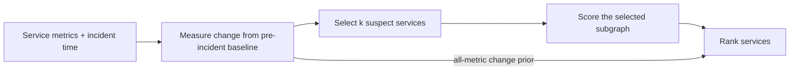

# STA root-cause ranking

STA ranks likely root-cause services from a metrics export for on-call engineers investigating a microservice incident.


## Install and run

From a cloned checkout:

```sh
python3 -m venv .venv
make install PYTHON=.venv/bin/python
.venv/bin/rca rank examples/incident.csv --inject-time 1700000002
```

## Key results

Public RCAEval RE1 grouped development and RE2 transfer, seeds 7, 42, 123, Intel Xeon CPU, one thread per ranker. Rebuild with `make bench` after [setting up RCAEval and the references](docs/rcaeval_data.md).

| Suite / system | STA AC@1 | STA Avg@5 | Best reference AC@1 | Best reference Avg@5 |
|---|---:|---:|---:|---:|
| RE1 Online Boutique | 0.947 ± 0.019 | 0.979 ± 0.019 | 0.693 CIRCA | 0.893 BARO |
| RE1 Sock Shop | 0.960 ± 0.057 | 0.984 ± 0.023 | 0.840 BARO and Nsigma | 0.947 Nsigma |
| RE1 Train Ticket | 0.840 ± 0.065 | 0.952 ± 0.023 | 0.573 BARO | 0.859 BARO |
| RE2 Online Boutique | 0.870 ± 0.005 | 0.952 ± 0.004 | 0.800 Nsigma | 0.911 Nsigma |
| RE2 Sock Shop | 0.870 ± 0.005 | 0.959 ± 0.006 | 0.844 Nsigma | 0.951 Nsigma |
| RE2 Train Ticket | 0.815 ± 0.005 | 0.888 ± 0.012 | 0.789 Nsigma | 0.842 Nsigma |

These are full-cohort results for per-system models, not the packaged pooled checkpoint. The [full table](benchmarks/results.md) includes all rankers, AC@3, failures, timings, and the fixed Train Ticket subset used for CIRCA and RCD. AC@1 is top-one accuracy; Avg@5 averages hit rates from ranks one through five.

## How it works



## Use and reproduce

- [Tutorial](docs/tutorial.md): rank your own CSV, call the Python API, or send a request to FastAPI via Docker.
- [Model card](docs/model_card.md) and [architecture](docs/architecture.md): know what the packaged RE1 model sees and how it differs from the evaluated models.
- [Public data and references](docs/rcaeval_data.md): download, fit and score the same public cases. `make bundle` rebuilds the packaged checkpoint.
- [Frozen paper results](docs/paper_results.md): historical results and the meaning of `benchmark.py`'s regression references. They are not current top-one measurements.
- `make demo` ranks the public showcase case and compares it with BARO. `make showcase` rebuilds the recording and figures. See [showcase setup](showcase/README.md).
- `make scaling` regenerates the synthetic size and timing benchmark. On the Intel Xeon CPU, one thread, batch one and a candidate cap of 16, STA's fitted slope was 3.78 ms per 1,000 services versus 4.33 ms for the full-graph GCN.

## Roadmap and known limitations

- RE2 Train Ticket still has a gap on loss faults. On the fixed subset STA ties Nsigma at top one. RE3 remains unevaluated.
- MicroRCA is unavailable for this comparison because the common metrics input lacks call-edge latency and host topology.
- STA latency grows with the number of services and is slower than the full-graph GCN at small sizes. See `make scaling`.
- The ranker requires a known incident start and currently uses metrics only. It cannot rank a service missing from the export. Scores are not probabilities.
